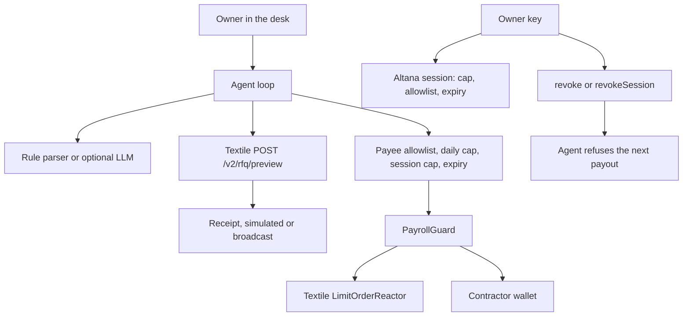

# Keel Payroll

Keel Payroll is an agent for a small business that pays contractors in their own stablecoin. The owner types a sentence. The agent checks an allowlist and two caps, asks Textile FX what the local coin costs, and — only when a wallet is armed — approves USD₮, swaps, and transfers the proceeds. A session can be revoked in one transaction. After that, the agent stops.

It is built for Celo's Agents Open for Business hackathon (Loops House, submissions close Mon 7 Dec 2026 09:00 GMT). The tracks are Stablecoin Corridors (Textile FX) and Altana Agent Wallets. Scoring is on Celo mainnet, chain 42220. The mainnet run is recorded in `submission/LOOPS.md`. The scripts that send are dry-run until you set `SEND=1` and `I_UNDERSTAND_MAINNET=1` on your own machine.


## Kane gate (end-to-end checks that the agent can't skip)

Every change the coding agent makes is checked by [Kane CLI](https://www.testmuai.com/kane-cli/) in a real
browser before the agent may stop, and before a deploy is promoted. Failures go back to the agent as its next
instruction. See [kane/README.md](kane/README.md).

## Architecture



Two rails, on purpose:

- **Stablecoin corridor.** A plain agent key calls `PayrollGuard`. The guard holds the USD₮, is the Textile taker, and implements ordinary ERC-1271. Every broadcast uses `withAttribution`, so the ERC-8021 suffix sits at the end of the transaction input.
- **Altana session.** The owner grants a session key with a contract allowlist, a daily USD₮ cap, and an expiry. Revoking it is one owner transaction. Textile's keyless taker proof does not accept that session's nested signature, so FX settlement stays on the guard. The evidence is in [docs/RISKS.md](docs/RISKS.md).

The public desk is mock mode. It still requests live Textile previews. It never signs.

**Public mock mode.** The desk can run on a public URL with no keys. It requests Textile preview quotes only and writes simulated receipts. It does not sign or broadcast.

## Run the desk

```bash
npm install
npm run dev
```

Open http://127.0.0.1:4477 . The sample instruction is on the desk:

`pay Maria (Brazil) $0.10 for the translation, Juan (Argentina) $0.20 for testing`

Maria and Juan in the mock are placeholder addresses, not real contractors. Replace them before a mainnet run.

## Tests and the fork

Foundry 1.10 is required for the Solidity tests (`forge`, `anvil` on `PATH`).

```bash
npm test
npm run test:forge
npm run test:fork
```

`test:fork` forks `https://forno.celo.org`. It checks that the Textile reactor and USD₮ are deployed, funds the guard with real USD₮ via `deal`, pays a payee, revokes, and shows the next execute revert.

The TypeScript fork demo tags a transaction the way the agent will:

```bash
anvil --fork-url https://forno.celo.org --port 18545 --host 127.0.0.1
npm run fork-demo
```

On the run recorded with this repo, the reactor bytecode was present, the payout transaction's input decoded as `celo_5bf71df0ebf6` (schema 0), revoke made the next `execute` revert, and a live preview turned $0.10 into about 0.592 wBRL.

## Environment

Copy `.env.example`. Nothing in it is a secret. Do not commit `.env`.

| Variable | Role |
| --- | --- |
| `KEEL_MODE`, `KEEL_ALLOW_LIVE` | Both must be set (`live` and `1`) before the desk will describe itself as live. The desk still does not broadcast. Settlement is `npm run settle`. |
| `LLM_API_KEY`, `LLM_BASE_URL`, `LLM_MODEL` | Optional OpenAI-compatible parser. Empty key uses the rule parser only. |
| `CELO_RPC_URL` | Default `https://forno.celo.org`. |
| `ANVIL_RPC_URL` | Loopback anvil for `fork-demo`. |
| `AGENT_PRIVATE_KEY` | Agent key. Guard caller and ERC-8004 registrant. |
| `OWNER_PRIVATE_KEY` | Guard owner and Altana admin. |
| `SESSION_SIGNER_PRIVATE_KEY`, `SESSION_FILE` | Altana session key, and the serialized session for revoke. |
| `PAYROLL_GUARD_ADDRESS`, `PAYEE_ADDRESS`, `PAYEE_COUNTRY`, `PAYOUT_USD` | Live settlement. |
| `TEXTILE_API_KEY` | Optional. Skips taker proof. Leave `includeAttribution` off. The app never sends it. |
| `ATTRIBUTION_CODE` | `celo_5bf71df0ebf6`. |
| `AGENT_PUBLIC_URL` | Origin used in the ERC-8004 file. |
| `SEND`, `I_UNDERSTAND_MAINNET` | Both must be `1` before a script broadcasts to a non-loopback RPC. |

Deploy the demo with `KEEL_MODE` unset. Vercel then serves the mock desk. Do not put mainnet keys in the Vercel project.

## How the track rules are met

Stablecoin Corridors and Altana are scored on execution, value, tagged onchain activity, and a named user with a real job (25% each). A miss on a track requirement means that track is not scored. Mainnet activity is what you still have to produce. The code paths are here.

| Requirement | Where |
| --- | --- |
| Every agent transaction carries `celo_5bf71df0ebf6` via `withAttribution` | [lib/wallet.ts](lib/wallet.ts) line 16, [lib/attribution.ts](lib/attribution.ts) lines 8 and 24 |
| Textile swap calldata is tagged, and a second tag is merged rather than stacked | [lib/settle.ts](lib/settle.ts) lines 80 and 125, [test/attribution.test.ts](test/attribution.test.ts), [test/risks.test.ts](test/risks.test.ts) line 21 |
| ERC-8004 registration from the agent wallet, plus the agent card | [scripts/register-8004.ts](scripts/register-8004.ts) line 19, [lib/registration.ts](lib/registration.ts) line 13, [public/.well-known/agent-card.json](public/.well-known/agent-card.json) |
| Guard: allowlist, daily USD₮ cap, expiry, one-transaction revoke, plain ERC-1271 | [contracts/PayrollGuard.sol](contracts/PayrollGuard.sol) lines 105, 122, and 147 |
| Altana session: cap, contract allowlist, expiry, revoke | [lib/altana-plan.ts](lib/altana-plan.ts) line 5, [scripts/session-grant-send.ts](scripts/session-grant-send.ts), [scripts/session-revoke.ts](scripts/session-revoke.ts) |
| Agent stops after revoke | [lib/agent.ts](lib/agent.ts) line 73, [test/agent.test.ts](test/agent.test.ts), [scripts/fork-demo.ts](scripts/fork-demo.ts) |
| Simulate before send | [lib/agent.ts](lib/agent.ts) `pay`, [lib/settle.ts](lib/settle.ts) lines 90 and 117 |
| Real USD₮ on a Celo mainnet fork | [test/forge/PayrollGuardFork.t.sol](test/forge/PayrollGuardFork.t.sol) |

Identity registry: `0x8004A169FB4a3325136EB29fA0ceB6D2e539a432`. Reactor: `0xa9AA0a64769cBed4d3B1Ceb4Df01CdE915C235b3`. USD₮: `0x48065fbBE25f71C9282ddf5e1cD6D6A887483D5e`.

## Demo script

1. Open the desk. The header should say Mock desk, Celo 42220, Armed. Rate chips load from Textile or show an error if the preview API is down.
2. Send the Maria and Juan sentence. The reply quotes each corridor Textile will price, says Simulated, and the meter moves by that amount. If a corridor has no maker online, that person is named and not paid. The others still get a receipt.
3. Send `every Friday pay Maria (Brazil) $1.00 for the weekly translation`. A rule is saved. Nothing is paid.
4. Open Revoke session and confirm. The banner says the agent is halted.
5. Send the payroll sentence again. Keel refuses, and no new receipt appears.

On a funded machine, after the fork demo looks right:

```bash
PAYROLL_GUARD_ADDRESS=0x… PAYEE_ADDRESS=0x… AGENT_PRIVATE_KEY=0x… \
  PAYOUT_USD=1.00 PAYEE_COUNTRY=Brazil \
  CELO_RPC_URL=https://forno.celo.org \
  SEND=1 I_UNDERSTAND_MAINNET=1 \
  npm run settle
```

Use a payee wallet that is not on the team. Keep each payout at the small end of what Textile will fill. The published default floor is $1. A signed firm request for $0.10 against an empty wallet came back `insufficient_funds` rather than a size error, so try the amount you mean and read the error. Do not assume $0.10 will fill. Preview already prices $0.10.

## Going live

1. Fund an owner key and a separate agent key with a little CELO for gas and at least the payout's USD₮. Gas on Celo is about $0.003. Budget the corridor notionals on top. Do not put either key on Vercel.
2. Deploy `PayrollGuard` with the owner, the agent, USD₮, a daily cap, and an expiry. Allow the reactor, USD₮, and the local tokens. Allow the contractor. Transfer USD₮ to the guard. The guard is the Textile taker.
3. `npm run register:8004` with `AGENT_PUBLIC_URL` set to the deployed desk, then `SEND=1` and `I_UNDERSTAND_MAINNET=1`. Read the agent id from the `Registered` event and update the registration file.
4. `npm run session:grant:send` to grant the Altana session. Keep the serialized session private. `npm run session:revoke` cuts it off.
5. `npm run settle` for one tagged conversion and the local-stablecoin transfer to the contractor.
6. Confirm the transaction with `verifyTx` from `@celo/attribution-tags`. Credit the transaction `input`, not an inner call hidden inside a relay bundle. See [docs/RISKS.md](docs/RISKS.md).
7. In the Loops submission, name the business and the contractor, and paste the explorer links. Copy is in [submission/LOOPS.md](submission/LOOPS.md).

## Accounts you would create

No account was created while building this.

- **Textile.** Quotes work with a wallet and no key. A partner key is optional: connect a wallet at the Textile app, open API keys. A `tx_test_…` key does not work on Celo. It only works on BNB testnet (chain 97) and Base Sepolia (chain 84532). Celo Sepolia has no Textile reactor.
- **Altana.** No API key. The SDK talks to `https://relay.altana.network`. The owner key pays the relay fee in CELO, USD₮, USDC, USA₮, or EURm. Testnet relay: `https://testnet-relay.altana.network`, faucet `https://faucet.celo.org/celo-sepolia`.
- **LLM.** Any OpenAI-compatible endpoint. Omit the key and the rule parser is the whole parser.
- **ERC-8004 and the attribution code.** No extra signup beyond the Loops enrollment that issued `celo_5bf71df0ebf6`.

## What is already demonstrated

- Rule parser, caps, allowlist, revoke halt, and receipts, without a model key.
- `withAttribution` on `writeContract`, including a Textile-shaped payload that is not double-tagged.
- An Altana `signOrder` signature longer than 65 bytes.
- Guard unit tests, and a Celo mainnet fork that moves real USD₮ and then halts.
- Anvil fork demo: tagged transaction input, revoke, live $0.10 wBRL preview.
- `next build` succeeds. `npm run dev` serves the desk.
